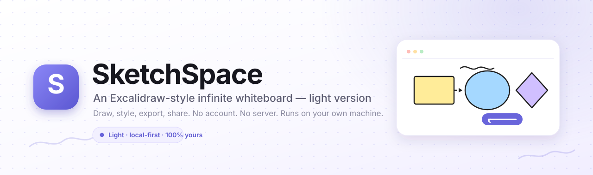
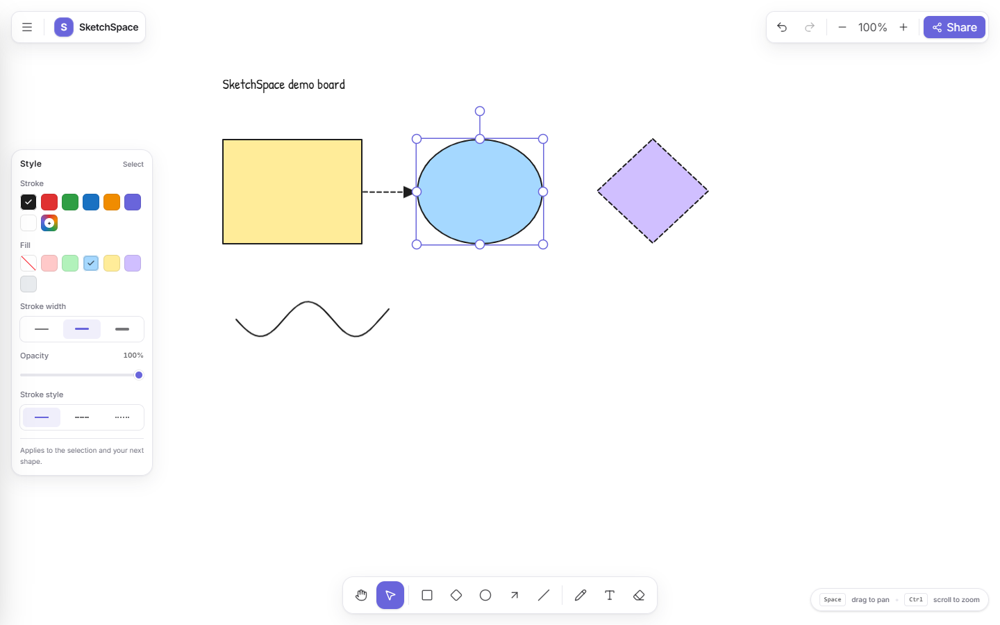
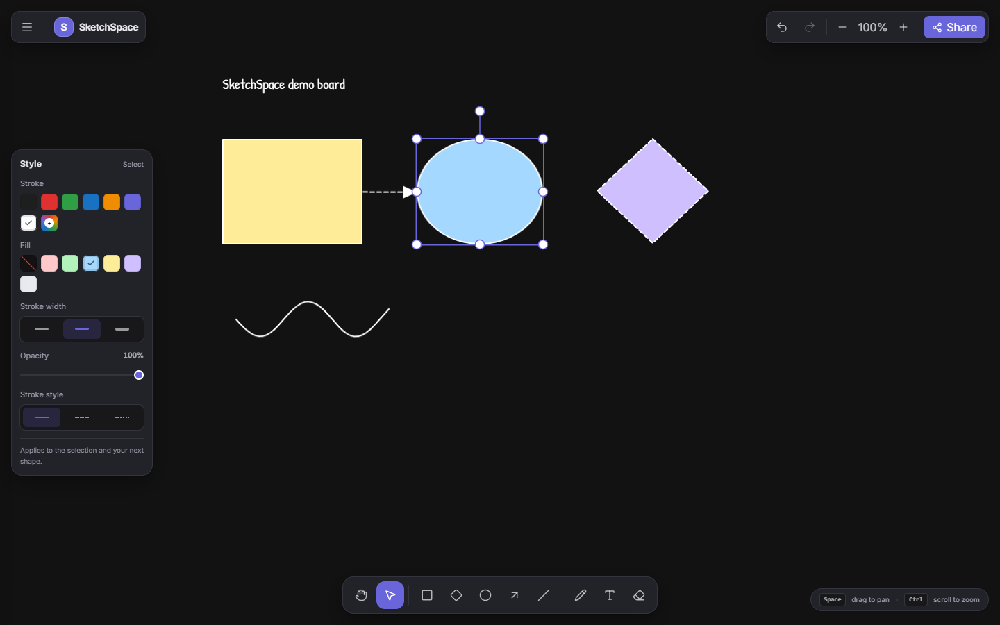
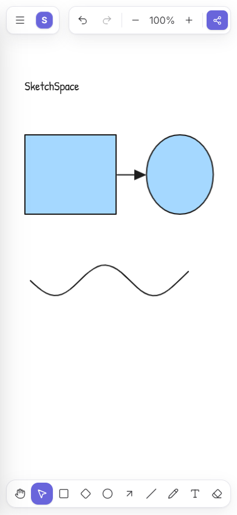

<div align="center">
  <picture>
    <source media="(prefers-color-scheme: dark)" srcset=".github/assets/banner-dark.svg" />
    
  </picture>
</div>

<h3 align="center">An infinite, Excalidraw-style whiteboard that fits in one folder.</h3>

<p align="center">
  Draw, style, erase, undo, export and share — <b>100% in your browser</b>.<br />
  No sign-up, no database, no server, no tracking. Clone it and it runs on your PC.
</p>

<p align="center">
  <a href="https://sketchspace-whiteboard.vercel.app"></a>
  <a href="LICENSE"></a>
  <a href="docs/testing-report.md"></a>
  <a href="https://github.com/MaryamMumtaz-piaic/sketch-space/issues"></a>
</p>

<p align="center">
  
  
  
  
  
  
</p>

<p align="center">
  <a href="#-this-is-the-light-version"><b>Light version</b></a> ·
  <a href="#-live-demo"><b>Live demo</b></a> ·
  <a href="#-features"><b>Features</b></a> ·
  <a href="#-quick-start"><b>Quick start</b></a> ·
  <a href="#-keyboard-shortcuts"><b>Shortcuts</b></a> ·
  <a href="#-tech-stack"><b>Tech stack</b></a> ·
  <a href="#-license"><b>License</b></a>
</p>

---

## ⚡ This is the light version

This repository is the **light edition** of SketchSpace — **same to same**: the
same tools, the same shortcuts, the same style panel, the same exports and the
same look as the full board, packaged as a small, backend-free build.

- **Same features, lighter footprint** — every drawing tool and every export
  option is here; what is left out is server-side machinery nobody needs for a
  whiteboard.
- **Runs on your own PC** — no account, no API keys, no database, no cloud.
  `npm install` and `npm run dev` is the whole setup.
- **Small and quiet** — a handful of focused dependencies, one static page, and
  a production bundle of roughly **135 kB** of first-load JavaScript.
- **Yours to keep** — drawings live in your browser and in files you download,
  never on someone else's server.

## 🌐 Live demo

**[sketchspace-whiteboard.vercel.app](https://sketchspace-whiteboard.vercel.app)**

The hosted build is the same code as this repository. Prefer your own machine?
[Run it locally](#-quick-start) — it behaves identically.

## 🖼 Screenshots

| Light theme | Dark theme |
| :---: | :---: |
|  |  |

<p align="center">
  
</p>

## ✨ Features

### Canvas and app shell

- Full-screen, responsive shell with no page scrollbars
- Top bar with menu, undo/redo, zoom controls and share
- Floating Excalidraw-style toolbar, bottom centre
- Slide-in sidebar with every menu action
- Style panel with the classic Excalidraw stroke and fill palettes
- Infinite Fabric.js canvas on plain white / `#121212`
- Pan with the Hand tool, **Space + drag**, middle-drag or trackpad scroll
- Zoom with **Ctrl + scroll**, centred on the pointer
- Zoom buttons and a click-to-reset percentage readout, clamped **10%–3000%**
- Light and dark themes stored in `localStorage` with no flash on reload
- Help dialog with the live keyboard map, Inter + Patrick Hand typography

### Drawing tools

- Rectangle, ellipse, diamond, line and arrow drawn by dragging, with a live preview
- Arrows are a shaft + filled arrowhead group, so they move and resize as one object
- Freehand pencil that follows the stroke colour and width
- Multi-line text with Patrick Hand 20 px, 240 px wrapping and double-click editing
- Selection: click, drag-box, Shift + click, move, resize, rotate and **Delete**
- Object eraser that removes whole shapes by clicking or dragging over them
- Every object gets a unique **nanoid**; new shapes are selected after drawing
- Dark mode flips new-shape strokes to white while keeping existing colours

### Styling, erasing and history

- Stroke, fill, width, opacity and solid / dashed / dotted controls
- Style changes apply to the **current selection** as well as the next shape
- The panel mirrors the selected object, so reopening a shape shows its real style
- Object eraser (whole shapes) and a **soft eraser** that clips inside shapes
- Soft eraser with three brush sizes and a ring cursor that matches the brush
- Undo / redo with a 50-snapshot JSON history, **Ctrl+Z**, **Ctrl+Shift+Z**, **Ctrl+Y**
- Undo/redo buttons disable themselves when there is nothing to undo or redo
- Gestures such as dragging or erasing collapse into a single history step

### Files, export and sharing

- **Save Project** downloads `sketchspace-YYYY-MM-DD.json` and keeps a browser copy
- **Autosave** (500 ms debounce) restores the drawing after a refresh
- **Open File** validates project type and version, with friendly errors for bad files
- **Reset Canvas** asks for confirmation and clears the canvas and its autosave
- **Export as image** to PNG, JPEG or SVG, at 1x / 2x / 3x (SVG stays vector)
- Background on / off, with transparent PNGs when it is off
- Exports contain only the drawing — never the toolbar, dialogs or handles
- **Share Link** compresses the whole drawing into a `#data=` URL with lz-string
- Share links are validated before loading, with a friendly fallback to the autosave
- Boards whose link would pass 30,000 characters offer a `.json` download instead
- Quota-safe autosave: a full `localStorage` shows a warning instead of breaking

### Touch and small screens

- Two-finger **pinch zoom**, clamped to 10%–3000%
- Touch pan, tap-to-select and drag-to-draw
- A "pick a tool and start drawing" hint on an empty board

## 🚀 Quick start

**Requirements:** Node.js 20 or newer, and npm.

```bash
git clone https://github.com/MaryamMumtaz-piaic/sketch-space.git
cd sketch-space
npm install
npm run dev
```

Open **[http://localhost:3000](http://localhost:3000)** and start drawing. There
are no environment variables, no API keys and no database to set up.

### Scripts

| Command | What it does |
| --- | --- |
| `npm run dev` | Dev server with Turbopack |
| `npm run build` | Optimised production build |
| `npm run start` | Serve the production build |
| `npm run lint` | Lint with ESLint |

### Production build

```bash
npm run build
npm run start
```

## ⌨️ Keyboard shortcuts

| Action | Shortcut | Action | Shortcut |
| --- | --- | --- | --- |
| Selection | `V` / `1` | Hand (pan) | `H` |
| Rectangle | `R` | Diamond | `D` |
| Ellipse | `O` | Line | `L` |
| Arrow | `A` | Pencil | `P` |
| Text | `T` | Eraser | `E` |
| Pan while any tool is active | `Space` + drag | Zoom to pointer | `Ctrl` + scroll |
| Undo | `Ctrl` + `Z` | Redo | `Ctrl` + `Shift` + `Z` / `Ctrl` + `Y` |
| Delete selection | `Delete` / `Backspace` | Edit a text label | Double-click |
| Open / close menu | `M` | Help | `?` |
| Back to selection / close dialog | `Esc` | | |

The same map is available inside the app from **Help (`?`)**.

## 🧱 Tech stack

| Layer | Choice | Why |
| --- | --- | --- |
| Framework | [Next.js 15](https://nextjs.org) (App Router) | One static route, zero-config build |
| Language | [TypeScript 5](https://www.typescriptlang.org) | Typed tools, shapes and history |
| UI | [React 19](https://react.dev) | Hooks-first canvas lifecycle |
| Styling | [Tailwind CSS 4](https://tailwindcss.com) | Theme tokens, no CSS sprawl |
| Canvas | [Fabric.js 6](https://fabricjs.com) | Objects, transforms, serialisation |
| Erasing | [@erase2d/fabric](https://github.com/erase2d/erase2d) | Soft eraser that clips inside shapes |
| State | [Zustand 5](https://zustand-demo.pmnd.rs) | Tiny store outside the canvas loop |
| Themes | [next-themes](https://github.com/pacocoursey/next-themes) | No flash on reload |
| Icons | [lucide-react](https://lucide.dev) | Consistent 1.5 px icon set |
| IDs | [nanoid](https://github.com/ai/nanoid) | Compact unique object IDs |
| Share links | [lz-string](https://github.com/pieroxy/lz-string) | Whole drawing inside a URL |

## 🗂 Project structure

```text
app/                  App Router entry, fonts, metadata, manifest, favicon
components/
  canvas/             Fabric canvas wrapper, stage, drawing tools, history
  toolbar/            Floating toolbar, tool buttons, style panel
  topbar/             Top bar, zoom controls, undo/redo
  sidebar/            Slide-in menu and its actions
  dialogs/            Help, export, share and confirm dialogs
  whiteboard/         Full-screen shell and theme sync
  ui/                 Buttons, dialog, tooltip, toast, logo
hooks/                Keyboard shortcut bindings
lib/                  Constants, helpers, download, persistence, share links
  fabric/             Shapes, arrows, serialisation, styling, history
stores/               Zustand UI store
types/                Shared TypeScript types
docs/                 Plan, daily notes, testing and final reports
.github/assets/       README banners
```

The canvas lives in Fabric.js; React only mounts it and keeps the UI in sync.
Effects, selection and styling are handled in `useFabricCanvas`, drawing gestures
in `useDrawingTools`, and every committed change pushes a JSON snapshot so undo
and autosave stay in step.

## 🔒 Local-first and private

- No accounts, no cookies, no analytics, no telemetry, no third-party requests
- Drawings are saved to `localStorage` and to files you download yourself
- Share links carry the drawing **in the URL fragment**, which browsers never send
  to a server
- Nothing in this app phones home — you can run it offline on `localhost`

## 🧪 Testing

The release was checked by hand end to end: **178 passing checks** — 126 on the
local dev and production builds plus 52 on the live deployment — across Chrome,
Edge, Firefox and a touch viewport.

- [Testing report](docs/testing-report.md) — every check, browser and result
- [Final report](docs/final-report.md) — what shipped and what was left out

## 📚 Documentation

| Document | What is inside |
| --- | --- |
| [Plan](docs/plan.md) | Scope, architecture and day-by-day plan |
| [Tasks](docs/tasks.md) | The full checklist, ticked off |
| [Day 1](docs/day-1.md) · [2](docs/day-2.md) · [3](docs/day-3.md) · [4](docs/day-4.md) · [5](docs/day-5.md) | Build log for each day |
| [Testing report](docs/testing-report.md) | 178 manual checks across browsers |
| [Notes](docs/notes.md) | Fabric.js, lz-string and canvas notes |
| [Final report](docs/final-report.md) | Release summary |

## 🚧 Not included (by design)

- Real-time collaboration, accounts and cloud sync — they need a server; this
  light edition is deliberately local-only
- Image upload, shape libraries, frames and a laser pointer
- Rough.js hand-drawn wobble — the brief asked for clean geometric shapes
- A fully native mobile layout — desktop-first, with touch pan, pinch and draw
- Short share links — links carry the whole drawing, with a JSON fallback when
  a URL would get too long

## 🤝 Contributing

Issues and pull requests are welcome — this is a learning project that got
finished, and it is better with other eyes on it.

1. **Found a bug?** Open an [issue](https://github.com/MaryamMumtaz-piaic/sketch-space/issues)
   with the browser, the steps and a screenshot if you can.
2. **Want to change the code?** Fork the repo, work on a branch, and open a pull
   request. Tell me what you changed and why.
3. **Keep it light.** No new dependency unless it earns its place, TypeScript
   everywhere, and `npm run lint` should stay clean.
4. **Credit stays.** Forks must keep this license and the author credit — see
   [LICENSE](LICENSE) sections 3 and 4.

Please do not publish this project, or a rebranded copy of it, as your own work
or under your own name. Fork it, learn from it, improve it, send the changes
back — that is the point.

## 📄 License

**SketchSpace Light License 1.0** — source-available, attribution required.
See **[LICENSE](LICENSE)** for the binding text.

| ✅ You can | 🚫 You cannot |
| --- | --- |
| Read, run and study the code | Claim you wrote it |
| Fork it and change it | Remove the author credit or this license |
| Self-host it, privately or publicly | Republish it as your own project or portfolio piece |
| Use it commercially, with credit | Rebrand it with a new name or logo |
| Send improvements back as a PR | Sell it as a standalone product |

This is intentionally **not** the MIT license and not an OSI-approved open-source
license: the code is public so people can learn from it, run it and build on it,
but it may not be taken over and presented as someone else's work. If you are
unsure whether your use is allowed, open an issue and ask — the answer is
usually yes.

## 🙏 Credits

Built by **[Maryam Mumtaz](https://github.com/MaryamMumtaz-piaic)**.

Inspired by [Excalidraw](https://excalidraw.com) — the toolbar, the style panel
and the keyboard map deliberately follow its conventions. Standing on the
shoulders of [Fabric.js](https://fabricjs.com), [@erase2d](https://github.com/erase2d/erase2d),
[Next.js](https://nextjs.org), [Tailwind CSS](https://tailwindcss.com),
[Zustand](https://github.com/pmndrs/zustand), [lucide](https://lucide.dev),
[lz-string](https://github.com/pieroxy/lz-string) and
[next-themes](https://github.com/pacocoursey/next-themes).

Fonts: [Inter](https://rsms.me/inter/) for the UI and
[Patrick Hand](https://fonts.google.com/specimen/Patrick+Hand) for the text tool.

## ⭐ Support

If SketchSpace is useful to you, a star helps other people find it — and it is
the easiest way to say thanks.

<p align="center">
  <a href="https://star-history.com/#MaryamMumtaz-piaic/sketch-space&Date">
    
  </a>
</p>

<p align="center">
  <sub>Made with care, one canvas at a time.</sub>
</p>
